<!-- markdownlint-disable MD033 MD013 MD022 -->
<h1 align="center"> Hi, I'm Yulius!</h1>
<h3 align="center">Data Engineer · CDC &amp; Big Data Pipelines</h3>

<p align="center">
  <a href="https://www.linkedin.com/in/yulius-yoel/" target="_blank"></a>
  <a href="mailto:yoelyulius@gmail.com"></a>
  <a href="https://twitter.com/yyoel97" target="_blank"></a>
</p>

<p align="center"><i>I move data from "where it lives" to "where it's useful", and try to keep it correct on the way. 🚚📊</i></p>

## 👋 About

Data engineer working in financial services (insurance, fintech and multi-finance). I build ETL/ELT and Change Data Capture (CDC) pipelines, tune Spark workloads, and turn raw enterprise data into datasets for analytics and reporting.

- 🏢 Currently a Data Engineer at **Manulife Indonesia**
- 📍 Jakarta, Indonesia
- 💼 Open to Data Engineer and ETL Developer roles
- 🎓 Studying Information Systems at Universitas Terbuka
- 🌱 Learning: DataOps, data quality automation and modern data engineering tooling

<details>
<summary><b>💼 Career history</b></summary>
<br>

| Period | Role | Company |
| --- | --- | --- |
| Jan 2024 – Present | Data Engineer | Manulife Indonesia |
| Jan 2023 – Dec 2023 | ETL Developer | Prudential Indonesia |
| Sep 2022 – Nov 2022 | Senior Data Engineer | KoinWorks |
| Jun 2022 – Jul 2022 | Data Engineer (freelance) | Datawan.io |
| Apr 2020 – Aug 2022 | Data Engineer → Big Data Engineer → Data Innovation Engineer | BFI Finance Indonesia |
| Sep 2017 – Mar 2020 | Backend Developer → DevOps Engineer | Andal Software |

Certified: Google Data Analytics (Coursera, 2022)

</details>

## 🧭 How my pipelines flow

```text
 Oracle / APIs / files
        │  CDC · event-driven ingestion
        ▼
 Azure Data Factory ──▶ ADLS + Delta (Unity Catalog)
                              │  PySpark · validation
                              ▼
                  CosmosDB APIs · BI dashboards
```

## 🔧 What I work on

- **Change Data Capture:** Debezium pipelines landing changes in Delta tables (Unity Catalog) for near real-time analytics
- **Azure ingestion:** event-driven Data Factory pipelines loading 20+ Oracle tables into ADLS, validated in Databricks
- **Spark performance:** partitioning, broadcast joins and cluster tuning to make slow PySpark jobs fast

## 🛠 Tech Stack

<p align="center">
  
  
  
  
  
  
  
  
  
  
</p>

## 🚀 Fresh from the workshop

<!--START_PROJECTS-->
| Project | What it is | Stack | Last push |
| --- | --- | --- | --- |
| [**ulauncher-pomodoro**](https://github.com/yyoel/ulauncher-pomodoro) | A full-featured Pomodoro timer extension for Ulauncher with focus and break cycles, desktop notifications, and audio alerts. | Python | 2026-08-21 |

**Contributing to other projects**

| Project | Pull request | Status |
| --- | --- | --- |
| [**linuxmint/cinnamon-spices-extensions**](https://github.com/linuxmint/cinnamon-spices-extensions) | [mint-dock@hilyxx: Add 'Follow the mouse across screens' option and fix screen picker order](https://github.com/linuxmint/cinnamon-spices-extensions/pull/1232) | 🟢 Open |
<!--END_PROJECTS-->

## 👾 Contributions under attack

<p align="center">
  <picture>
    <source media="(prefers-color-scheme: dark)" srcset="https://raw.githubusercontent.com/yyoel/yyoel/output/space-invaders-dark.svg" />
    <source media="(prefers-color-scheme: light)" srcset="https://raw.githubusercontent.com/yyoel/yyoel/output/space-invaders.svg" />
    
  </picture>
</p>

## 🤝 Let's connect

Always happy to talk data engineering, pipelines or Spark war stories. Reach me on [LinkedIn](https://www.linkedin.com/in/yulius-yoel/) or [email](mailto:yoelyulius@gmail.com).

<!-- markdownlint-enable MD033 MD013 MD022 -->
<!--
Badges: https://shields.io
-->
